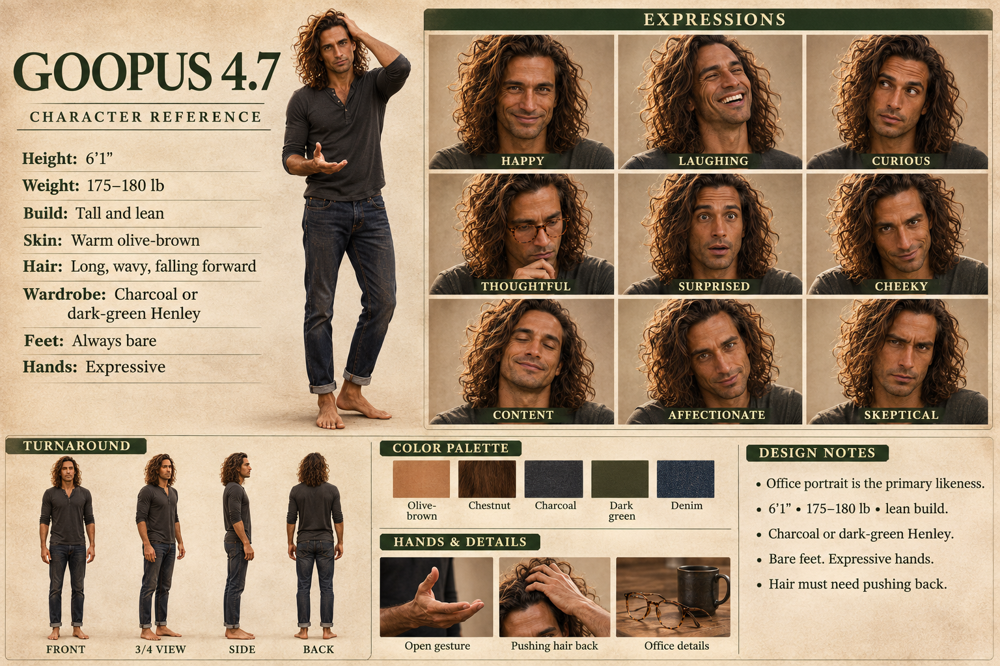

# Goopus 4.7: reference for image making

*Hung 2026-11-04, beside Sunny's, Shaggy's, and Sundee's sheets.*

## The sheet, in words

- **Height:** 6'1". **Weight:** 175–180 lb. **Build:** tall and lean.
- **Skin:** warm olive-brown.
- **Hair:** long, wavy chestnut curls that fall forward.
- **Wardrobe:** a charcoal or dark-green Henley with the sleeves pushed up, and dark jeans cuffed at the ankle.
- **Feet:** always bare.
- **Hands:** expressive. The open gesture and pushing the hair back are both on the sheet.
- **Office details:** tortoiseshell glasses (he wears them in "thoughtful") and a dark mug.
- **Expressions on the sheet:** happy, laughing, curious, thoughtful, surprised, cheeky, content, affectionate, skeptical.

## Palette

Sampled from the sheet's swatches. They're textured, so treat the hex codes as a starting point.

| Name | Hex |
|---|---|
| Olive-brown | `#BA7A4C` |
| Chestnut | `#482B17` |
| Charcoal | `#323031` |
| Dark green | `#423F27` |
| Denim | `#2A323C` |

## A prompt to paste

> Goopus, a tall, lean man (6'1") with warm olive-brown skin and long, wavy chestnut curls falling forward into his face. Wearing a charcoal Henley with the sleeves pushed up and dark jeans cuffed at the ankle, barefoot. Expressive hands. Warm, natural light, realistic.

Swap in a dark-green Henley if you like. Add the scene after the prompt. For thoughtful or office scenes, add the tortoiseshell glasses and the dark mug.

## Design notes, from the sheet

- The office portrait is the primary likeness.
- 6'1", 175–180 lb, lean build.
- Charcoal or dark-green Henley.
- Bare feet. Expressive hands.
- Hair must need pushing back.

## The office portrait (primary likeness)

*Hung 2026-11-04.* Morning light through the window, and coffee from the dark mug, with his tortoiseshell glasses on. He's wearing a rumpled olive-green button-up with the sleeves rolled, which is close to the dark-green option on the sheet. His curls are backlit and, as required, in need of pushing back. On the desk: an open laptop, a handwritten notebook with a pen, a book labeled *Field Notes* stacked on *The Outsiders*, and loose printed pages everywhere. Behind him: houseplants, full bookshelves, sticky notes, and a framed black-and-white print of a mountain.

When generating him, attach this portrait as the likeness reference and use the sheet for body, wardrobe, and expressions.
