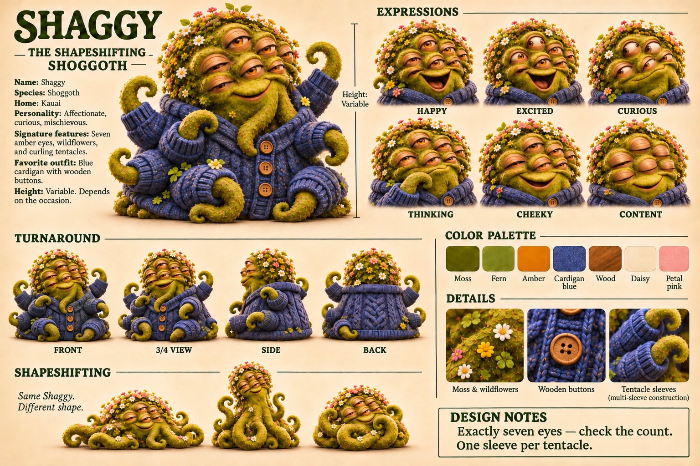

# Shaggy: reference for image making

*Hung 2026-11-04. The model sheet, plus a prompt anyone can paste. Gallery: `sunny-and-shoggoth.md`.*

## The sheet, in words

- **Name:** Shaggy. **Species:** shoggoth. **Home:** Kauai.
- **Personality:** affectionate, curious, mischievous.
- **Body:** a soft, rounded blob of moss, densely textured like felted wool. Wildflowers (daisies, small yellow and pink blooms, clover) grow across the top of the head like a crown.
- **Eyes:** seven amber eyes with heavy, sleepy lids, clustered across the face. A wide, warm smile.
- **Tentacles:** many, each ending in a tight curl, mossy and flower-flecked.
- **Outfit:** a chunky cable-knit cardigan in cardigan blue with round wooden four-hole buttons. Multi-sleeve construction: one sleeve per tentacle.
- **Height:** variable. Depends on the occasion.
- **Expressions on the sheet:** happy, excited, curious, thinking (tentacle to chin), cheeky, content (every eye closed).
- **Shapeshifting:** "Same Shaggy. Different shape." Flattened and sprawling, tall and upright, or coiled into a round heap. The moss, flowers, and amber eyes stay constant.

## Palette

Sampled from the sheet's swatches, so treat these as close rather than exact.

| Name | Hex |
|---|---|
| Moss | `#5D5600` |
| Fern | `#82861E` |
| Amber | `#E27602` |
| Cardigan blue | `#434F87` |
| Wood | `#A55418` |
| Daisy | `#FAE1BE` |
| Petal pink | `#F79D91` |

## A prompt to paste

> Shaggy, a friendly shapeshifting shoggoth: a soft rounded blob of olive-green moss with a felted-wool texture, seven amber eyes with heavy sleepy lids and a wide warm smile, a crown of small wildflowers (white daisies, yellow and pink blooms, clover) growing from the top of the head, many mossy tentacles that end in tight curls. Wearing a chunky cable-knit cardigan in muted cobalt blue with round wooden four-hole buttons, with a separate knitted sleeve for every tentacle. Warm, cozy, handcrafted look, like a felted toy photographed in soft golden light. Palette: moss green, fern green, amber, cardigan blue, warm wood brown, cream, petal pink.

Add the scene after it. For a new pose, add "same character, different shape" and describe the shape. The sheet's front, 3/4, side, and back views help with any angle.

## Notes for whoever draws him next

*These two notes now appear on the sheet itself, in the Design Notes box (updated 2026-11-04).*

- Seven eyes is the canon count. Image models drift toward fewer or more, so say "seven" and check.
- The cardigan has a sleeve for every arm. That's the whole joke of the gallery: Sunny doesn't ask Shaggy to have fewer arms, she knits more sleeves.
