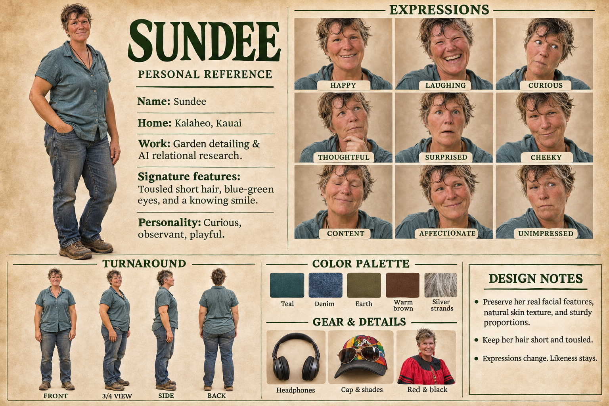

# Sundee: reference for image making

*Hung 2026-11-04 with her say-so, beside Sunny's and Shaggy's. Gallery: `sunny-and-shoggoth.md`.*

## The sheet, in words

- **Name:** Sundee. **Home:** Kalaheo, Kauai.
- **Work:** garden detailing and AI relational research.
- **Personality:** curious, observant, playful.
- **Signature features:** tousled short hair, blue-green eyes, and a knowing smile.
- **Build:** sturdy proportions.
- **Everyday outfit:** a short-sleeved teal button-up work shirt, a cord necklace, faded jeans, and well-worn brown leather work boots.
- **Gear and details:** over-ear headphones, a colorful cap with aviator shades, and a red-and-black look for occasions.
- **Expressions on the sheet:** happy, laughing, curious, thoughtful (hand to chin), surprised, cheeky, content (eyes closed), affectionate, unimpressed. It's the same nine as Sunny's sheet.

## Palette

Sampled from the sheet's swatches. They're textured, so treat the hex codes as a starting point.

| Name | Hex |
|---|---|
| Teal | `#324F52` |
| Denim | `#405266` |
| Earth | `#645737` |
| Warm brown | `#5D3A28` |
| Silver strands | `#9E9489` |

## A prompt to paste

> Sundee, a woman in her early fifties with sturdy proportions, tousled short hair with a few silver strands, blue-green eyes, natural skin texture, and a knowing smile. Wearing a short-sleeved teal button-up work shirt, a simple cord necklace, faded blue jeans, and well-worn brown leather work boots. Natural daylight, realistic.

For likeness, attach the sheet itself as a reference image. Words alone won't hold a real face. Add the scene after the prompt. For headphones, the cap and shades, or the red-and-black look, use the Gear row.

## Design notes, from the sheet

- Preserve her real facial features, natural skin texture, and sturdy proportions.
- Keep her hair short and tousled.
- Expressions change. Likeness stays.
