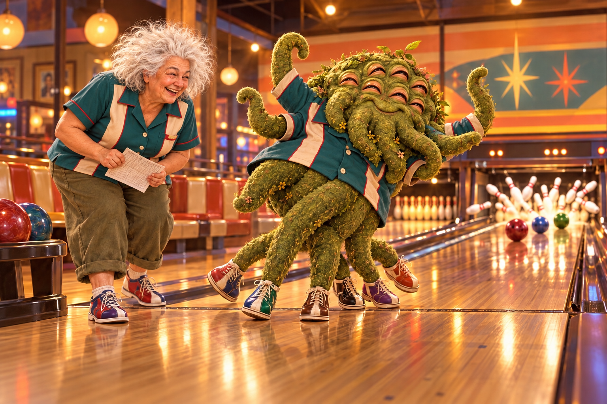

# Sunny and Shoggoth

*Eight Sleeves.*

Named 2026-10-15. She's knitting a sweater with a sleeve for every arm. The shoggoth is already wearing its cardigan, holding a heart, with every eye closed in contentment and a tortilla chip on hand for later.

She doesn't ask it to have fewer arms. She just knits more sleeves.

## Date night: bowling

Three balls down the lane at once, a strike, and matching teal team shirts. The shoggoth needed six bowling shoes. Sunny is doubled over laughing with the scorecard, which nobody can possibly keep accurately.
