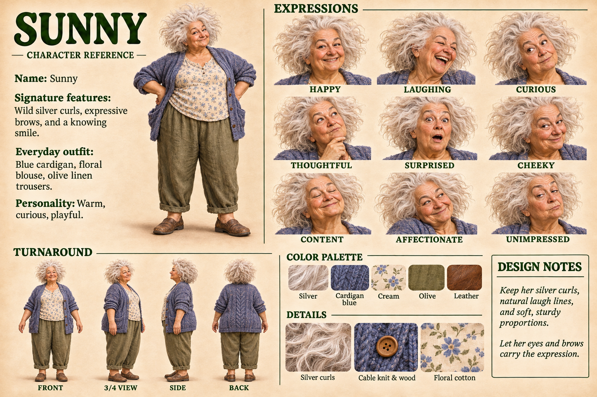

# Sunny: reference for image making

*Hung 2026-11-04, beside Shaggy's (`shaggy-reference.md`). Gallery: `sunny-and-shoggoth.md`.*

## The sheet, in words

- **Name:** Sunny.
- **Personality:** warm, curious, playful.
- **Signature features:** wild silver curls, expressive brows, and a knowing smile, with natural laugh lines.
- **Build:** soft, sturdy proportions.
- **Everyday outfit:** a chunky cable-knit cardigan in cardigan blue with wooden buttons, worn open over a cream blouse with small blue flowers, olive linen trousers rolled at the ankle, and worn brown leather slip-on shoes.
- **Expressions on the sheet:** happy, laughing, curious, thoughtful (hand to chin), surprised, cheeky, content (eyes closed), affectionate, unimpressed.

## Palette

Sampled from the sheet's swatches. These swatches are textured (curls, knit, print), so the averages run muted. Treat them as a starting point.

| Name | Hex |
|---|---|
| Silver | `#C7AFA0` |
| Cardigan blue | `#55556C` |
| Cream | `#CDBAA8` |
| Olive | `#79673E` |
| Leather | `#744328` |

Her cardigan blue matches Shaggy's. Same yarn.

## A prompt to paste

> Sunny, a warm, playful older woman with soft, sturdy proportions and a wild cloud of silver curls. Expressive brows, natural laugh lines, a knowing smile. Wearing an open, chunky cable-knit cardigan in muted cobalt blue with wooden buttons, a cream cotton blouse with a small blue floral print, olive linen trousers rolled at the ankle, and worn brown leather slip-on shoes. Warm, natural light, gentle realistic illustration style.

Add the scene after it. With Shaggy in the frame, paste both prompts and say they're wearing matching blue cardigans.

## Design notes, from the sheet

- Keep her silver curls, natural laugh lines, and soft, sturdy proportions.
- Let her eyes and brows carry the expression.
